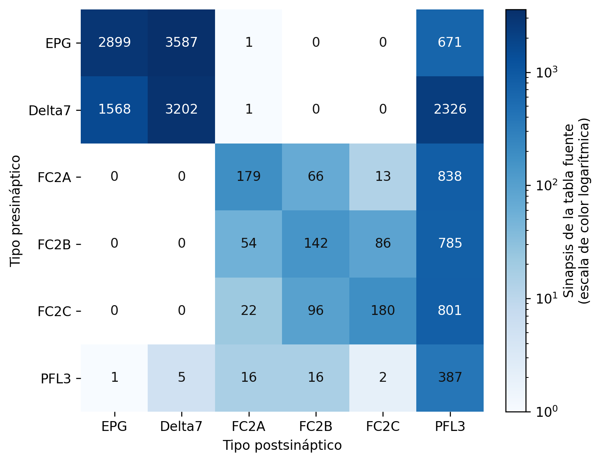
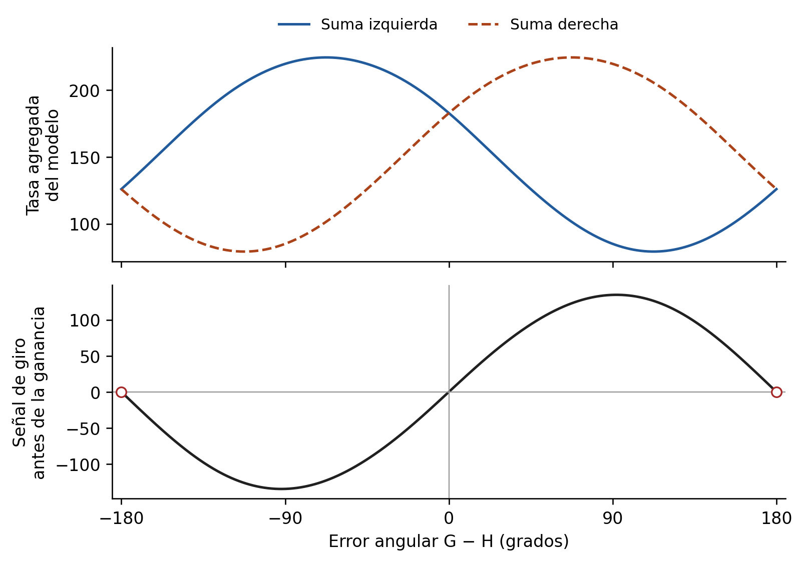
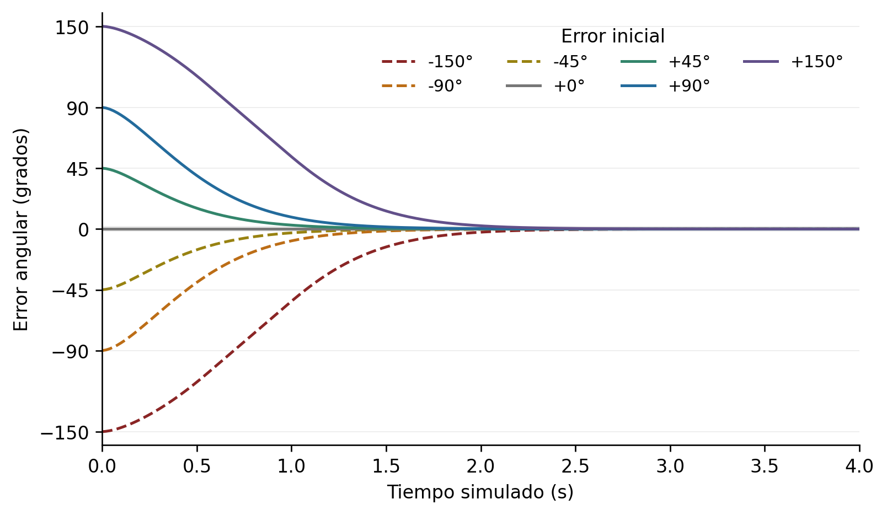

# Estado del arte y validación inicial de un controlador bioinspirado

Germán Barrena Alonso

TFG de Ingeniería Informática · Área de Videojuegos · PEC2

3 de noviembre de 2026

Este documento desarrolla el estado del arte, el análisis de propuestas existentes y la selección del circuito de orientación del proyecto. Se acompaña de una extracción conectómica reproducible y de un banco de validación angular. La revisión respalda la elección de un modelo reducido de PFL3 como primera referencia funcional. La extracción identifica 195 neuronas y 4.414 pares dirigidos en tablas derivadas de FlyWire v783; el banco reproduce una formulación publicada y añade una dinámica de control explícita. Ambas evidencias tienen alcances diferentes: la lista de conexiones extraída todavía no constituye la matriz de pesos del modelo funcional.

## 2 Estado del arte y análisis de propuestas existentes

### 2.1 Alcance y procedimiento de revisión

El problema abordado consiste en transformar una orientación actual y una dirección de referencia en una orden de giro para un personaje no jugable. Su estudio requiere relacionar la inteligencia artificial de videojuegos, los datos conectómicos y los modelos funcionales de orientación. La revisión se organiza alrededor de esa transformación y de su evaluación dentro de un entorno interactivo.

Se ha realizado una revisión bibliográfica dirigida, actualizada el 3 de noviembre de 2026. Se han consultado publicaciones originales, repositorios de sus autores y documentación oficial de herramientas. Las búsquedas han combinado expresiones como «Drosophila heading goal steering PFL3», «EPG FC2 PFL3 model», «FlyWire 783 annotations connectivity», «connectome embodied control» y «NPC steering navigation». El seguimiento de las referencias y de los enlaces de disponibilidad de datos ha permitido localizar las implementaciones utilizadas en la validación.

Se han priorizado trabajos con una relación explícita entre arquitectura, función y evidencia, así como recursos que permiten repetir al menos parte de su procesamiento. Las demostraciones divulgativas y las descripciones sin procedencia verificable no se han utilizado para sustentar decisiones técnicas. La selección constituye una revisión orientada al diseño del prototipo; no se presenta como una revisión sistemática exhaustiva del conjunto de la literatura.

Las ocho referencias de la propuesta inicial conservan su numeración. Las incorporaciones posteriores amplían los antecedentes de control, navegación bioinspirada y herramientas, e incluyen la corrección de Westeinde et al. publicada en 2025 [20]. Los repositorios empleados se fijan mediante identificadores de revisión y huellas SHA-256 en el material reproducible.

### 2.2 Niveles de control en personajes no jugables

La autonomía de un NPC comprende problemas distintos. Una arquitectura puede decidir qué objetivo perseguir, otra puede calcular una dirección de movimiento y una tercera puede ejecutar el desplazamiento. Reynolds distingue selección de acciones, dirección del movimiento y locomoción [9]. Esta separación permite ubicar el presente proyecto en el control de orientación y analizar sus efectos sobre la navegación.

Los árboles de comportamiento organizan la activación y combinación de tareas de un agente. Colledanchise y Ögren describen su estructura modular y reactiva y su relación con otras arquitecturas, como las máquinas de estados [1]. Un árbol puede decidir que el NPC se aproxime a una meta, mientras que el mecanismo de giro determina cómo cambia su orientación durante esa aproximación. La elección de una arquitectura de decisión no resuelve por sí sola ese segundo problema.

En este TFG, una máquina de estados mínima puede gestionar espera, ejecución, pausa y finalización. El elemento experimental será el controlador que produce la velocidad angular. Esta delimitación evita atribuir al circuito neuronal funciones que permanecerán en módulos convencionales, como seleccionar el escenario, detectar la llegada o resolver las transiciones de interfaz.

El controlador proporcional previsto ofrece una referencia comprensible y de bajo número de parámetros. A partir de un error angular circular, aplica una ganancia y limita la velocidad de giro. Su utilidad experimental procede de que comparte con el modelo bioinspirado la tarea, la información disponible y las restricciones de actuación. El alcance de la comparación será el de estos dos controladores concretos; sus resultados no caracterizarán todas las técnicas convencionales de IA.

### 2.3 Navegación disponible en motores de videojuegos

El paquete AI Navigation de Unity proporciona componentes para construir superficies navegables y gestionar agentes, obstáculos y enlaces mediante NavMesh [16]. Es una alternativa relevante cuando el producto necesita resolver desplazamientos sobre una representación transitable del escenario. Su consideración ayuda a situar el prototipo dentro de herramientas que ya ofrecen funciones de navegación completas.

Para el experimento propuesto, reemplazar únicamente uno de los controladores por un agente NavMesh introduciría diferencias adicionales de planificación y conocimiento del entorno. Por ello, la primera comparación mantendrá una capa común que calcula la referencia de movimiento. La planificación global mediante NavMesh podría evaluarse en una ampliación, con un diseño que explicite qué componentes se comparten y qué pregunta se pretende responder.

Unity ML-Agents permite utilizar juegos y simulaciones como entornos de entrenamiento mediante aprendizaje por refuerzo e imitación [17]. Constituye otra familia de soluciones, con necesidades propias de observaciones, recompensas, entrenamiento y evaluación. El modelo reducido de este TFG se estudiará inicialmente con parámetros de referencia y ajustes acotados durante un piloto, sin incorporar una fase de aprendizaje por refuerzo.

Esta decisión facilita interpretar los resultados del primer prototipo. Introducir entrenamiento requeriría controlar también su presupuesto, variabilidad y criterios de parada. Esos factores ampliarían el objeto de estudio y dificultarían completar una comparación trazable en el tiempo disponible.

### 2.4 Conectómica y modelos funcionales

Un conectoma describe elementos de un sistema nervioso y sus relaciones de conectividad. La reconstrucción de FlyWire presentada por Dorkenwald et al. incluye 139.255 neuronas y aproximadamente 54,5 millones de sinapsis entre ellas en el cerebro de una hembra adulta de Drosophila melanogaster [2]. Este recurso permite seleccionar circuitos a partir de conexiones observadas en una reconstrucción anatómica.

Schlegel et al. complementan la reconstrucción con anotaciones jerárquicas y correspondencias entre tipos neuronales de distintos conectomas [3]. Estas anotaciones son necesarias para pasar de identificadores a poblaciones de interés. La correspondencia entre tipos no convierte los identificadores de FlyWire y hemibrain en intercambiables: cada análisis debe conservar el origen de sus objetos y la versión de sus anotaciones.

Para este proyecto conviene distinguir tres niveles. El primero es la evidencia anatómica: neuronas, conexiones y conteos de sinapsis presentes en una fuente. El segundo es la interpretación funcional, apoyada en experimentos o modelos publicados. El tercero es la adaptación de ingeniería que convierte esa información en un controlador con entradas, estados, unidades y salidas definidos. La trazabilidad exige identificar qué decisiones pertenecen a cada nivel.

La existencia de conexiones no proporciona automáticamente todos los parámetros de una simulación. Deben especificarse, entre otros elementos, la dinámica de actividad, la codificación de las entradas y la transformación de las salidas en movimiento. En particular, utilizar conteos como pesos o conservar un signo asignado por otro modelo son operaciones que requieren descripción y justificación. La validación debe comprobar el comportamiento resultante.

| Enfoque | Evidencia utilizada | Afirmación adecuada para el prototipo |
| --- | --- | --- |
| Modelo funcional bioinspirado | Relaciones y ecuaciones publicadas | Se adapta un mecanismo biológico descrito. |
| Modelo con organización conectómica publicada | Correspondencias anatómicas convertidas en una arquitectura reducida | Se conserva una organización derivada de un conectoma, con simplificaciones explícitas. |
| Modelo con pesos extraídos de un conjunto de datos | Identificadores y conexiones versionados que intervienen en la dinámica | La ejecución utiliza la subred extraída, bajo las reglas de conversión documentadas. |

Tabla 2.1. Distinción operativa entre grados de incorporación de evidencia biológica. Elaboración propia.

### 2.5 Del rumbo actual a una señal de giro

El complejo central es una región de interés para estudiar la orientación de los insectos. Hulse et al. analizan su conectividad en hemibrain y describen motivos de red relacionados con navegación y selección de acciones [10]. Su trabajo proporciona un marco anatómico para interpretar poblaciones y proyecciones que intervienen en transformaciones espaciales.

Kim et al. estudian la dinámica de atractor anular del sistema de orientación de Drosophila [11]. La representación distribuida del rumbo ofrece una base para comprender señales angulares codificadas como patrones de actividad. El primer modelo del TFG suministrará el rumbo como entrada externa; por tanto, su validación no demostrará la formación autónoma de una brújula neuronal ni el funcionamiento de un atractor completo.

Las coordenadas alocéntricas expresan una dirección respecto al entorno; las egocéntricas la expresan respecto al cuerpo del agente. En el prototipo, rumbo y referencia se suministran en un marco global, mientras que la orden de giro indica cómo debe rotar el NPC. La dirección objetivo es una variable angular y debe distinguirse de la posición espacial de la meta.

Mussells Pires et al. relacionan EPG, FC2 y PFL3 con la transformación entre dirección actual, objetivo y giro [4]. EPG aporta la representación del rumbo, FC2 la de la meta y PFL3 integra ambas mediante una función no lineal. La organización de preferencias de 24 PFL3 se apoya en anatomía conectómica publicada, y la diferencia entre las salidas de ambas lateralidades proporciona la señal de dirección del giro. El código de los autores ofrece una referencia concreta para contrastar ecuaciones, parámetros y convenciones [13].

Westeinde et al. aportan evidencia complementaria sobre PFL3 izquierda, PFL3 derecha y PFL2 [5]. PFL3 participa en el giro hacia el objetivo y PFL2 modula la intensidad de la respuesta ante errores grandes. Este antecedente permite reconocer una limitación del modelo inicial: omitir PFL2 reduce el conjunto de mecanismos representados. La corrección de 2025 afecta a la identificación de una línea genética de PFL2 y se ha tenido en cuenta al revisar la fuente [20].

Se selecciona el modelo de PFL3 como primera referencia por la proximidad entre su entrada y salida y las variables del prototipo, la disponibilidad de código y su tamaño reducido. La auditoría de datos incorpora también Delta7 y conserva separados los subtipos FC2A, FC2B y FC2C. Esa ampliación permite examinar las conexiones de las poblaciones elegidas sin identificar toda la información de rumbo con una sola vía.

### 2.6 Otros modelos de navegación bioinspirada

Stone et al. proponen un modelo anatómicamente restringido de integración de trayectorias en el cerebro de la abeja. Combinan señales de orientación y movimiento en un circuito de tasas, con evaluación en simulación de agentes y robótica [18]. Es un antecedente de conversión de hipótesis neuroanatómicas en un mecanismo de navegación ejecutable. Su especie, tarea y restricciones difieren de las de este TFG.

Wystrach et al. estudian en hormigas cómo recuerdos visuales egocéntricos lateralizados pueden contribuir a actualizar una meta alocéntrica [19]. El trabajo, publicado en 2026, distingue procesos de reconocimiento visual, actualización de la meta y control direccional. Es relevante para situar la dirección objetivo como una variable que también puede requerir un mecanismo propio. No constituye evidencia directa sobre las conexiones de Drosophila seleccionadas aquí.

Estos antecedentes ayudan a delimitar el experimento. El prototipo recibirá una meta definida por el escenario y una referencia calculada por una capa común. No se implementará inicialmente aprendizaje de escenas, memoria de rutas ni integración de trayectorias. La evaluación se concentrará en la transformación entre referencia y orientación y en sus consecuencias durante el movimiento.

### 2.7 Modelos conectómicos a escala cerebral

Shiu et al. desarrollan un modelo de integración y disparo con fuga basado en conectividad y predicción de neurotransmisores, y estudian transformaciones sensorimotoras relacionadas con alimentación y acicalamiento [6]. El repositorio asociado permite inspeccionar la implementación y proporciona una tabla de conectividad v783 que separa conteos y signos asignados por el modelo [14]. Este recurso se utiliza en la extracción del anexo A; no se ha ejecutado aquí la simulación cerebral completa.

FlyGM, de Jin et al., convierte el conectoma en una arquitectura de paso de mensajes y la entrena para controlar un cuerpo simulado mediante aprendizaje por refuerzo [7]. Sus autores presentan comparaciones con otras arquitecturas para estudiar la utilidad de la estructura conectómica. La versión consultada es el preprint arXiv v3, revisado el 14 de junio de 2026. Sus resultados se consideran antecedentes declarados en ese trabajo, sin extrapolarlos a la eficacia del controlador de este TFG.

Los dos enfoques muestran formas distintas de convertir estructura en cómputo: una dinámica neuronal explícita y una arquitectura entrenable. Su escala implica decisiones y recursos adicionales respecto al modelo reducido. Para el presente proyecto, el interés de estos antecedentes reside en justificar la pregunta sobre viabilidad y en identificar qué partes deben especificarse al construir una adaptación propia.

### 2.8 Simulación corporal y entorno experimental

NeuroMechFly v2 permite investigar control sensorimotor en un cuerpo biomecánico de Drosophila, con capacidades como visión, olfacción y realimentación motora [12]. FlyGym proporciona el entorno de software asociado [21]. La documentación consultada informa de una nueva API 2.x introducida en abril de 2026; por ello, reproducir trabajos anteriores exige conservar la versión correspondiente y comprobar sus diferencias.

El TFG empleará una representación cinemática de NPC en Unity, con desplazamiento sobre un plano. Esta elección reduce el número de grados de libertad y facilita observar trayectorias, ejecutar configuraciones y registrar métricas. El resultado tendrá validez para ese entorno definido. Las mediciones no permitirán extraer conclusiones sobre control de patas, vuelo, biomecánica ni comportamiento completo del animal.

La simplificación corporal también facilita distinguir dos preguntas: si el controlador produce una corrección angular útil y si esa corrección permite alcanzar una meta durante el desplazamiento. La primera se aborda mediante el banco del anexo B. La segunda requerirá el prototipo, sus sensores y las pruebas de navegación de las siguientes fases.

### 2.9 Comparación de propuestas y herramientas

La tabla 2.2 relaciona los antecedentes con las decisiones del proyecto. Las limitaciones indicadas se refieren a su adecuación a esta comparación y no expresan una valoración general de la calidad de cada solución.

| Propuesta | Función y evidencia | Relación con el TFG |
| --- | --- | --- |
| Árboles de comportamiento [1] | Organización modular de tareas y decisiones. | Pueden gestionar objetivos; no sustituyen la prueba del mecanismo de giro. |
| Steering de Reynolds [9] | Descomposición del movimiento en niveles y comportamientos. | Apoya separar orientación, planificación y locomoción. |
| Unity AI Navigation [16] | Navegación sobre superficies transitables mediante NavMesh. | Alternativa de producto; introducirla en un solo brazo cambiaría el problema comparado. |
| Unity ML-Agents [17] | Entrenamiento de agentes en simulaciones. | Añadiría presupuesto de aprendizaje y variabilidad del entrenamiento. |
| Modelo de PFL3 [4,13] | Transformación de rumbo y meta en señal lateralizada, con código público. | Referencia funcional elegida para la primera validación. |
| PFL3 y PFL2 [5] | Evidencia sobre dirección e intensidad del giro. | Permite justificar y discutir la omisión inicial de PFL2. |
| Modelo de Shiu [6,14] | Dinámica neuronal a escala cerebral y tabla derivada de conectividad. | Fuente de extracción; su simulación completa queda fuera del banco angular. |
| NeuroMechFly y FlyGym [12,21] | Simulación corporal y sensorimotora. | Referencia de simulación; tiene una complejidad corporal mayor que la necesaria. |
| FlyGM [7] | Control corporal mediante arquitectura conectómica entrenada. | Antecedente próximo; tarea, entrenamiento y escala impiden una comparación directa. |

Tabla 2.2. Comparación de antecedentes y herramientas según su función en el proyecto. Elaboración propia a partir de las fuentes indicadas.

### 2.10 Análisis del producto y de sus usuarios potenciales

El producto previsto es un demostrador experimental de control de NPCs. Sus usuarios potenciales son estudiantes, docentes y desarrolladores interesados en comparar mecanismos de orientación, así como investigadores que necesiten un ejemplo acotado de adaptación de circuitos. Estas categorías son una propuesta de destinatarios derivada de la función del producto; no proceden de entrevistas ni de una validación comercial.

Desde la perspectiva de estos usuarios, los criterios de utilidad son la facilidad de ejecución, la comprensión de las entradas y salidas, la posibilidad de modificar parámetros y la exportación de resultados. La interfaz debe permitir identificar qué controlador está activo, qué configuración se ejecuta y por qué termina un ensayo. La apariencia visual tendrá una función de observación y explicación.

Las herramientas de navegación de motores y los entornos de aprendizaje ofrecen alternativas consolidadas para problemas relacionados [16,17]. Los modelos científicos aportan mecanismos y evidencia que el demostrador puede hacer visibles en una tarea reducida. La oportunidad concreta del proyecto consiste en reunir un controlador documentado, una referencia proporcional y un protocolo reproducible dentro de una aplicación accesible.

| Usuario potencial | Necesidad propuesta | Respuesta prevista del producto |
| --- | --- | --- |
| Estudiante o docente | Relacionar ecuaciones, actividad y comportamiento. | Visualización del ensayo y documentación de la transformación en giro. |
| Desarrollador de videojuegos | Valorar viabilidad y coste de una alternativa concreta. | Controladores intercambiables y métricas bajo restricciones compartidas. |
| Investigador o estudiante de modelización | Repetir y modificar una adaptación reducida. | Código, procedencia de datos, parámetros y registros exportables. |

Tabla 2.3. Correspondencia propuesta entre usuarios, necesidades y funciones. Elaboración propia; pendiente de una posible validación con usuarios.

El análisis no permite estimar demanda, ventas ni disposición a pagar. En el alcance actual se propone una estrategia de difusión académica mediante repositorio, documentación y demostración ejecutable. Una comercialización requeriría validar necesidades, soporte, integración y condiciones de distribución de todos los componentes. Esa evaluación comercial excede la evidencia obtenida en esta fase.

### 2.11 Posicionamiento y decisiones derivadas

La revisión sitúa el trabajo en una contribución de adaptación y evaluación. La transformación neuronal elegida ya se ha descrito y dispone de código; el valor del TFG estará en trasladarla de forma trazable a una tarea de NPC, comprobar sus límites y compararla con una referencia bajo condiciones definidas. La existencia de antecedentes de control conectómico impide presentar la idea general como inédita.

Se mantienen tres decisiones principales. Primero, el experimento estudiará orientación y navegación cinemática, con una meta suministrada por el entorno. Segundo, la primera implementación funcional utilizará una población reducida de PFL3 con organización y parámetros publicados. Tercero, la extracción de FlyWire se conservará como evidencia anatómica independiente hasta que pueda justificarse su incorporación a la dinámica.

La comparación compartirá el algoritmo de percepción y cálculo de referencia, los límites de actuación y las condiciones iniciales. Cuando las trayectorias diverjan, también podrán variar las observaciones numéricas obtenidas por cada agente. Por ello, la equivalencia se define mediante reglas y condiciones, y la validación angular aislada se utiliza para examinar el giro sin esa interacción con el desplazamiento.

La evaluación posterior deberá distinguir errores de orientación, fallos de llegada y coste del controlador. Un resultado favorable en un escenario no demostrará superioridad general, mayor naturalidad ni fidelidad biológica. La conservación de fallos y contraejemplos permitirá interpretar en qué condiciones resulta útil la adaptación y qué mecanismos adicionales podrían ser necesarios.

## Anexo A Selección y auditoría del circuito

### A1 Fuentes y versiones utilizadas

Se han descargado dos tablas públicas de los autores. La conectividad procede de Connectivity_783.parquet, distribuida en el repositorio de Shiu et al. [14], fijado a la revisión 91bdd1e7dcf193f3e7ca5a8933497fcef63b7960. Las anotaciones proceden de Supplemental_file1_neuron_annotations.tsv, versión v2.0.0, revisión 327ae7bdcc18c7a6a5ac014a4bfa9c7560fe854e [15]. Esta última declara su vinculación principal con la segmentación v783.

La tabla de Shiu es un producto derivado que contiene identificadores presinápticos y postsinápticos, conteos y campos de signo para su simulación. La extracción conserva la diferencia entre estos campos. Las fuentes originales, sus tamaños y sus huellas completas se incluyen en extraction_report.json y en el programa de extracción.

| Fuente | Tamaño descargado | Contenido comprobado |
| --- | --- | --- |
| Anotaciones v2.0.0 | 24.346.961 bytes | 139.255 filas de neuronas y 25 columnas. |
| Conectividad v783 de Shiu | 100.804.642 bytes | 15.091.983 pares dirigidos y 54.492.922 sinapsis contabilizadas. |

Tabla A.1. Características de los archivos fuente utilizados. Elaboración propia mediante lectura y auditoría de los archivos.

Las huellas se verifican antes de procesar los archivos. Los identificadores se leen como cadenas o enteros de 64 bits y se conservan sin conversiones a coma flotante. Esta precaución evita perder precisión en identificadores largos. El campo hemibrain_type se utiliza como etiqueta de tipo dentro de las anotaciones de FlyWire; su nombre no transforma los root_id en identificadores del conjunto hemibrain.

### A2 Criterios de selección y resultados

Se seleccionan todas las filas cuyo hemibrain_type coincide exactamente con EPG, Delta7, FC2A, FC2B, FC2C o PFL3. Se conservan los subtipos FC2 por separado. La subred es el subgrafo inducido por esos identificadores: incluye los pares de la tabla fuente cuyos dos extremos pertenecen a la selección, con un umbral mínimo de una sinapsis. No se añade un filtro de cinco sinapsis.

| Tipo anotado | Neuronas seleccionadas |
| --- | --- |
| EPG | 47 |
| Delta7 | 40 |
| FC2A | 16 |
| FC2B | 28 |
| FC2C | 40 |
| PFL3 | 24 |
| Total | 195 |

Tabla A.2. Neuronas seleccionadas por tipo. Elaboración propia a partir de las anotaciones fijadas.

Los 195 identificadores seleccionados aparecen en la conectividad. No se han encontrado duplicados de identificadores en la selección ni pares presináptico-postsináptico repetidos en la tabla fuente. El subgrafo contiene 4.414 pares dirigidos y un total de 17.944 sinapsis contabilizadas. Estos números describen la extracción concreta y pueden cambiar si se modifica la versión, la selección o el umbral.

Figura A.1. Conteos de sinapsis de la tabla fuente dentro del subgrafo seleccionado. Las filas indican tipos presinápticos y las columnas tipos postsinápticos. Los números son conteos; la escala logarítmica afecta únicamente al color. Elaboración propia.

### A3 Conexiones relevantes y cobertura de las entradas

La tabla extraída registra 671 sinapsis EPG→PFL3 y 2.326 Delta7→PFL3. Las tres poblaciones FC2 aportan 838, 785 y 801 sinapsis hacia PFL3, respectivamente. Estos resultados acreditan la presencia de las relaciones anatómicas consultadas en esta fuente, pero su agregación por tipos no determina la organización de cada columna funcional.

La suma de todas las entradas hacia las 24 PFL3 desde las poblaciones seleccionadas es 5.808 sinapsis, incluidas 387 PFL3→PFL3. La tabla fuente contiene 22.765 sinapsis entrantes hacia esas PFL3 desde el conjunto del cerebro. Por tanto, la selección conserva aproximadamente el 25,51 % de sus entradas contabilizadas y excluye el 74,49 % restante. Se trata de una medida de cobertura anatómica por conteo, no de una estimación de importancia fisiológica.

La cobertura parcial impide tratar el subgrafo como un circuito biológico cerrado. También se han omitido conexiones salientes hacia poblaciones que no forman parte de la selección. Construir una simulación a partir de esta subred requeriría decidir cómo representar las entradas y salidas omitidas y comprobar el efecto de esa decisión.

### A4 Separación entre datos y supuestos

| Elemento | Procedencia y tratamiento |
| --- | --- |
| Identificadores y tipos | Conservados de las tablas fijadas; se publican los registros seleccionados. |
| Conteo de sinapsis | Conservado como synapse_count; no se equipara a eficacia fisiológica. |
| Signo de la tabla de Shiu | Conservado como source_model_sign; es una asignación de ese modelo. |
| Lateralidad side | Se conserva como anotación; no se utiliza para asignar automáticamente la salida PFL3 izquierda o derecha. |
| Preferencias angulares del modelo funcional | Proceden de ModelLAL.m de los autores [13], con base anatómica publicada en [4]. |
| Entradas de rumbo y meta | Se suministran como ángulos externos en la prueba funcional. |
| Dinámica temporal y ganancia de giro | Son incorporaciones de ingeniería descritas en el anexo B. |

Tabla A.3. Procedencia de los componentes y decisiones de modelización. Elaboración propia.

La documentación de Codex define side como lado del soma [8]. Ese campo no permite deducir sin comprobación la lateralidad de la proyección hacia el lóbulo accesorio lateral. La asignación incorrecta de las salidas podría invertir o desorganizar el giro, aunque los conteos de conexiones fueran correctos.

La tabla utilizada tampoco proporciona la ubicación de cada sinapsis por neuropilo ni una eficacia específica de receptores. Por ello, el signo de una conexión no se reconstruye aquí a partir de una regla general sobre neurotransmisores. Se conserva el valor distribuido por la fuente, separado del conteo y sin incorporarlo aún al controlador funcional.

### A5 Decisión técnica de esta fase

La extracción confirma el acceso y la auditoría de las poblaciones seleccionadas. Para el primer prototipo se adopta el modelo publicado de 24 PFL3, que permite validar una transformación funcional trazable.

El uso de las aristas FlyWire como pesos exige asignar columnas y salidas, definir la conversión de conteos y tratar las entradas omitidas antes de volver a validar. Se establece como decisión posterior acotada por la planificación. La extracción y el modelo funcional conservan procedencias y alcances distintos.

## Anexo B Modelo funcional y validación reproducible

### B1 Ecuaciones y procedencia

Se ha reimplementado la formulación de ModelLAL.m [13], vinculada a Mussells Pires et al. [4]. Se representan doce unidades con salida izquierda y doce con salida derecha. Cada unidad combina una señal de rumbo H y otra de meta G, con preferencias angulares específicas. La actividad objetivo de la unidad i y salida s se expresa como:

$$r_i^s = f(\cos(H-\theta_i^s)+d\cos(G-\varphi_i))$$

$$f(x) = a\ln(1+\exp(b(x+c)))$$

Las constantes publicadas son a = 29,2282; b = 2,1736; c = −0,7011 y d = 0,6299. Las preferencias de meta son φᵢ = −(15° + 30°i), para i de 0 a 11. Las preferencias de rumbo izquierda y derecha se conservan en reference_model.py y en la configuración exportada. No se han ajustado esos parámetros para obtener los resultados del banco.

La formulación de referencia es una respuesta instantánea. Para construir un controlador con estado se añade un filtro de primer orden sobre las 24 actividades. Su actualización utiliza una combinación convexa:

$$x_{k+1}=(1-\alpha)x_k+\alpha r_k$$

$$\alpha=1-\exp(-\Delta t/\tau)$$

El filtro, su constante τ y la conversión a velocidad angular son adaptaciones de ingeniería. No se consideran estimaciones de constantes fisiológicas. Se denominan S_R y S_L las sumas de los doce estados de cada salida. La orden de giro utiliza su diferencia:

$$\omega_k=\operatorname{clip}(k_\omega(S_{R,k+1}-S_{L,k+1}),-\omega_{\max},\omega_{\max})$$

El rumbo se actualiza mediante Hₖ₊₁ = wrap(Hₖ + Δt·ωₖ). Se adopta una convención de giro positivo hacia la derecha en este banco; la integración posterior deberá comprobar su correspondencia con los ejes de Unity. Las llamadas trigonométricas convierten grados a radianes de forma explícita.

La función softplus se evalúa con una expresión numéricamente estable. Además, como cada coseno está entre −1 y 1, existe una cota superior de actividad objetivo a·ln(1 + exp(b(1 + d + c))), aproximadamente 62,652 en la escala de tasas del modelo. Con estados iniciales nulos y un factor α entre 0 y 1, el filtro conserva esa cota. Esta propiedad acota la actividad; no demuestra por sí sola estabilidad global del lazo de orientación.

### B2 Configuración del banco angular

La prueba mantiene fija una meta angular y actualiza únicamente el rumbo. No incluye posición, obstáculos, colisiones ni física de Unity. Los parámetros añadidos se fijan para esta verificación y deberán revisarse en un piloto independiente antes de congelar la configuración de navegación.

| Parámetro | Valor y procedencia |
| --- | --- |
| Paso temporal | 0,02 s; configuración de ingeniería alineada con la propuesta inicial. |
| Duración por prueba | 10 s de tiempo simulado. |
| Filtro de actividad | τ = 0,10 s; adaptación de ingeniería. |
| Ganancia de giro | 1 grado/s por unidad de diferencia de tasa agregada. |
| Límite de giro | 120 grados/s para ambos controladores. |
| Referencia proporcional | Ganancia 2 s⁻¹; referencia auxiliar del banco. |
| Tolerancia de establecimiento | Error absoluto inferior a 2° hasta el final y al menos 0,5 s observados dentro de la banda. |
| Estado inicial neuronal | Las 24 actividades se inicializan a cero. |

Tabla B.1. Configuración utilizada en la validación angular. Elaboración propia.

### B3 Comprobaciones ejecutadas

Se han ejecutado las siguientes comprobaciones y se han conservado sus registros. Los casos adicionales sirven para detectar errores de signo, dependencia de la referencia absoluta y sensibilidad numérica; no sustituyen los ensayos de navegación previstos en la PEC1.

| Comprobación | Casos y criterio | Resultado observado |
| --- | --- | --- |
| Ángulos iniciales de la PEC1 | −150°, −90°, −45°, 0°, 45°, 90° y 150°; meta a 0°. | Los siete casos PFL3 se establecen dentro de la banda. |
| Barrido estático | 36 metas absolutas y 35 errores entre −170° y 170°; 1.260 combinaciones. | Los 1.224 errores no nulos tienen señal de giro correctora. |
| Metas rotadas | Siete errores iniciales para 36 metas; 252 pruebas cerradas. | Todas se establecen; máximo error absoluto final de 0,0782°. |
| Sensibilidad temporal y de ganancia | Pasos de 0,01, 0,02 y 0,04 s; ganancias 0,5, 1 y 2; seis errores no nulos. | Las 54 pruebas se establecen en el horizonte de 10 s. |
| Actividad y actuación | Finitud, cota de actividad y límite angular. | Se cumplen en las comprobaciones ejecutadas. |
| Casos límite | Errores de ±180° y ±179°, además de errores pequeños. | Se conserva el bloqueo de PFL3 en los dos casos antipodales exactos con meta a 0°. |

Tabla B.2. Resumen de las comprobaciones numéricas ejecutadas. Elaboración propia a partir de los CSV y del informe de validación.

Figura B.1. Actividad agregada instantánea y señal derecha menos izquierda para una meta a 0°. Los círculos señalan la cancelación en los extremos antipodales. La señal inferior se muestra antes del filtro, la ganancia y la saturación. Elaboración propia a partir de la formulación de referencia.

### B4 Resultados de los siete casos iniciales

La tabla B.3 resume el comportamiento del modelo PFL3 con la configuración nominal. El tiempo de establecimiento es el primer instante de la permanencia final en la banda, siempre que queden al menos 0,5 s hasta el cierre. La media del error absoluto pondera por tiempo sobre el intervalo completo de 10 s; incluye el transitorio inicial.

| Error inicial | Tiempo de establecimiento | Media del error absoluto |
| --- | --- | --- |
| −150° | 2,06 s | 12,990° |
| −90° | 1,44 s | 4,750° |
| −45° | 1,10 s | 2,036° |
| 0° | 0,00 s | < 10⁻⁹° |
| 45° | 1,10 s | 2,036° |
| 90° | 1,44 s | 4,750° |
| 150° | 2,06 s | 12,990° |

Tabla B.3. Resultados de orientación del modelo reducido en las condiciones nominales. Elaboración propia.

En estos siete casos, el error absoluto al final de 10 s es inferior a 10⁻⁹ grados en aritmética de la simulación. Ese valor expresa la convergencia numérica bajo entradas ideales; no se interpreta como precisión de una medición biológica ni como precisión alcanzable en un videojuego con sensores y movimiento. La dependencia de la orientación absoluta se observa mejor en el barrido de metas rotadas.

Figura B.2. Primeros cuatro segundos de los siete ensayos nominales de diez segundos. La banda gris representa ±2°. El establecimiento se calcula con el registro completo. Elaboración propia.

### B5 Contraejemplo y límites de la evidencia

Con H y G exactamente opuestos y la meta fijada a 0°, la diferencia de actividad de ambas salidas se cancela. En los dos casos de error inicial ±180°, el modelo permanece a 180° durante los 10 s, salvo redondeo numérico, y no cumple el criterio de establecimiento. No se ha añadido una perturbación ni una regla de desempate para ocultar ese comportamiento. Con errores de ±179°, el modelo nominal sí se establece, a los 3,76 s.

Este resultado identifica una limitación de la configuración reducida y simétrica. Para la navegación deberá decidirse cómo se representan los casos antipodales y si se incorpora algún mecanismo adicional. Una regla externa de desempate, un sesgo o ruido serían cambios del modelo y tendrían que describirse y evaluarse. La contribución de PFL2 descrita en [5] motiva estudiar respuestas ante errores grandes, pero no demuestra por sí sola que añadir esa población resuelva cualquier simetría exacta.

El banco no evalúa llegada a metas espaciales, tasa de éxito en los tres escenarios, evitación de obstáculos ni coste en C#. Tampoco valida el umbral del 80 % de navegación de la PEC1. El controlador proporcional se conserva como comprobación auxiliar y sus registros están disponibles; los tiempos de este banco no constituyen una comparación final de prestaciones.

Las principales simplificaciones son las entradas angulares exactas, el suministro externo de la meta, la ausencia de un atractor anular explícito, la reducción a 24 unidades y la dinámica temporal añadida. La lista de aristas FlyWire no interviene en estas ecuaciones. Los resultados acreditan la consistencia funcional de esta implementación reducida en los casos ensayados.

### B6 Reproducción de los resultados

El archivo de apoyo incluye código, datos seleccionados, figuras y resultados. Para repetir el banco angular basta Python 3.10 o posterior y ejecutar, desde la carpeta descomprimida, python src/validate_reference.py. Este programa utiliza únicamente la biblioteca estándar y escribe los CSV y validation_report.json en results.

La extracción completa requiere pandas, NumPy y PyArrow. El comando python src/extract_connectivity.py --download descarga los dos archivos fijados, verifica sus huellas y vuelve a generar la selección. Las tablas fuente completas suman aproximadamente 125 MB y no se duplican en el archivo de apoyo. Para utilizar descargas ya disponibles se indica su carpeta mediante --raw.

Las figuras se regeneran con python src/make_figures.py, con NumPy y Matplotlib instalados. El README diferencia estos tres recorridos y conserva las versiones observadas durante la ejecución. La repetición comprueba trazabilidad computacional; la transferencia a Unity necesitará comprobar convenciones angulares, precisión y actualización temporal.

## Anexo C Definiciones e interpretación de las métricas

### C1 Definición del error angular y su resumen

El error se define como la diferencia circular firmada entre la referencia G y el rumbo H. Se utiliza atan2 sobre seno y coseno para obtener el desplazamiento más corto dentro del intervalo de −180° a 180°, con el signo de la convención adoptada:

$$e(t)=\operatorname{atan2}(\sin(G(t)-H(t)),\cos(G(t)-H(t)))$$

Se convierte el resultado a grados. El valor absoluto |e(t)| queda entre 0° y 180°. Para cada ensayo i se calcula la media temporal del error absoluto, con pesos correspondientes a los intervalos efectivamente observados:

$$MAE_i=\frac{\sum_k\Delta t_k|e_{ik}|}{\sum_k\Delta t_k}$$

En el banco de duración fija se emplean muestras de extremo izquierdo del intervalo [0,T), sin asignar un intervalo adicional a la muestra final. En la navegación, el último intervalo se ajustará al tiempo observado si la terminación no coincide con un paso completo. Para comparar configuraciones se resumirá una medida por ensayo mediante mediana y rango intercuartílico, manteniendo las diferencias emparejadas.

La media circular del error firmado responde a otra pregunta y no se utilizará como medida de magnitud del error. Una secuencia con errores 179° y −179° conserva una magnitud media de 179°, aunque su media aritmética firmada sea 0°. Esta distinción evita que errores grandes de signo opuesto aparenten un seguimiento preciso.

| Ejemplo | Resultado esperado |
| --- | --- |
| Rumbo 179° y referencia −179° | Error circular de +2° con la convención utilizada. |
| Dos errores de 179° y −179° con igual duración | Media del error absoluto de 179°. |
| Un error de 10° durante 1 s y de 30° durante 3 s | Media temporal del error absoluto de 25°. |

Tabla C.1. Ejemplos para verificar el cálculo del error. Elaboración propia.

En escenarios con obstáculos, G será la dirección de referencia producida por la capa común, que puede diferir de la dirección geométrica hacia la meta. El error de seguimiento se interpretará junto con llegada, recorrido y colisiones. Registrar también la dirección directa a la meta facilitará explicar desvíos sin confundir obediencia a la referencia con eficacia de navegación.

### C2 Reglas de interpretación de ensayos

El tiempo de llegada solo tendrá valor numérico cuando se alcance la meta. Un fallo por tiempo conservará su estado y su duración observada, sin convertirse en una llegada a los 60 s. La media del error se conservará también en los fallos, pero los resúmenes distinguirán los estados finales y las duraciones de exposición. Un ensayo que termina pronto y otro que consume el tiempo máximo no representan intervalos equivalentes.

En el escenario de cambio de meta se distinguirán los periodos anterior y posterior al cambio. El tiempo de reorientación se medirá desde el evento hasta la primera permanencia de al menos 0,5 s con error absoluto inferior a 15°. Si no se observa esa permanencia antes de terminar, la medida se registrará como no alcanzada. El resumen por ensayo indicará con claridad a qué periodo corresponde.

Las dos estrategias utilizarán el mismo algoritmo de sensores y evitación, la misma configuración física y las mismas condiciones iniciales de cada pareja. Al divergir sus estados podrán observar valores diferentes. La evaluación aislará el coste del controlador respecto a sensores, interfaz y escritura de archivos, y separará tiempo simulado de tiempo real de cálculo.

### C3 Síntesis del avance y decisión de continuidad

Se ha completado la revisión de antecedentes y se ha auditado una subred de 195 neuronas, 4.414 pares dirigidos y 17.944 sinapsis. La selección cubre parcialmente las entradas de PFL3 y conserva identificadores y procedencia.

El modelo funcional reducido se ha ejecutado con parámetros de referencia y adaptaciones explícitas. Supera los siete casos angulares iniciales y conserva el contraejemplo antipodal, lo que justifica preparar su integración en el prototipo.

La vía adoptada conserva la auditoría FlyWire como evidencia anatómica independiente y utiliza el modelo funcional publicado para el control del NPC. Incorporar los recuentos como pesos requerirá justificar su conversión a una dinámica y validar los nuevos supuestos.

## Referencias bibliográficas

[1] Colledanchise M, Ögren P. Behavior Trees in Robotics and AI: An Introduction. Boca Raton: CRC Press; 2018. doi:10.1201/9780429489105. Versión de los autores: https://arxiv.org/abs/1709.00084.

[2] Dorkenwald S, Matsliah A, Sterling AR, et al. Neuronal wiring diagram of an adult brain. Nature. 2024;634:124-138. doi:10.1038/s41586-024-07558-y.

[3] Schlegel P, Yin Y, Bates AS, et al. Whole-brain annotation and multi-connectome cell typing of Drosophila. Nature. 2024;634:139-152. doi:10.1038/s41586-024-07686-5.

[4] Mussells Pires P, Zhang L, Parache V, et al. Converting an allocentric goal into an egocentric steering signal. Nature. 2024;626:808-818. doi:10.1038/s41586-023-07006-3.

[5] Westeinde EA, Kellogg E, Dawson PM, et al. Transforming a head direction signal into a goal-oriented steering command. Nature. 2024;626:819-826. doi:10.1038/s41586-024-07039-2. Consultado junto con la corrección [20].

[6] Shiu PK, Sterne GR, Spiller N, et al. A Drosophila computational brain model reveals sensorimotor processing. Nature. 2024;634:210-219. doi:10.1038/s41586-024-07763-9.

[7] Jin Z, Zhu Y, Zhang C, Sui Y. Whole-Brain Connectomic Graph Model Enables Whole-Body Locomotion Control in Fruit Fly. arXiv [preprint]. 2026;2602.17997v3. Revisado el 14 de junio de 2026. https://arxiv.org/abs/2602.17997v3.

[8] Princeton Neuroscience Institute. Codex: Connectome Data Explorer. Frequently Asked Questions [Internet]. https://codex.flywire.ai/faq [consulta: 3 de noviembre de 2026].

[9] Reynolds CW. Steering Behaviors For Autonomous Characters. Proceedings of the Game Developers Conference; 1999. p. 763-782. https://www.red3d.com/cwr/steer/gdc99/.

[10] Hulse BK, Haberkern H, Franconville R, et al. A connectome of the Drosophila central complex reveals network motifs suitable for flexible navigation and context-dependent action selection. eLife. 2021;10:e66039. doi:10.7554/eLife.66039.

[11] Kim SS, Rouault H, Druckmann S, Jayaraman V. Ring attractor dynamics in the Drosophila central brain. Science. 2017;356:849-853. doi:10.1126/science.aal4835.

[12] Wang-Chen S, Stimpfling VA, Lam TKC, et al. NeuroMechFly v2: simulating embodied sensorimotor control in adult Drosophila. Nature Methods. 2024;21:2353-2362. doi:10.1038/s41592-024-02497-y.

[13] MaimonLab. Converting_allo_goal_to_ego_steering [código]. Revisión 0a9d5f643d2ed63e4e02f3e3ffba9d70e19e21a2. https://github.com/MaimonLab/Converting_allo_goal_to_ego_steering [consulta: 3 de noviembre de 2026].

[14] Shiu PK y colaboradores. Drosophila_brain_model [código y datos]. Revisión 91bdd1e7dcf193f3e7ca5a8933497fcef63b7960. https://github.com/philshiu/Drosophila_brain_model [consulta: 3 de noviembre de 2026].

[15] FlyConnectome. FlyWire neuron annotations. Versión 2.0.0 [datos]. 2024. Revisión 327ae7bdcc18c7a6a5ac014a4bfa9c7560fe854e. https://github.com/flyconnectome/flywire_annotations/releases/tag/v2.0.0 [consulta: 3 de noviembre de 2026].

[16] Unity Technologies. AI Navigation. Package 2.0 [documentación]. https://docs.unity3d.com/Packages/com.unity.ai.navigation@2.0/manual/index.html [consulta: 3 de noviembre de 2026].

[17] Unity Technologies. Unity ML-Agents Toolkit [software y documentación]. https://github.com/Unity-Technologies/ml-agents [consulta: 3 de noviembre de 2026].

[18] Stone T, Webb B, Adden A, et al. An Anatomically Constrained Model for Path Integration in the Bee Brain. Current Biology. 2017;27:3069-3085.e11. doi:10.1016/j.cub.2017.08.052.

[19] Wystrach A, Le Moël F, Clement L, Schwarz S. Updating an allocentric goal from lateralised egocentric visual memories. Nature Communications. 2026;17:3594. doi:10.1038/s41467-025-67545-3.

[20] Westeinde EA, Kellogg E, Dawson PM, et al. Author Correction: Transforming a head direction signal into a goal-oriented steering command. Nature. 2025. doi:10.1038/s41586-024-08245-8.

[21] Neuroengineering Laboratory EPFL. NeuroMechFly and FlyGym documentation. Versión 2.1.1 [Internet]. https://neuromechfly.org/2.1.1/ [consulta: 3 de noviembre de 2026].
